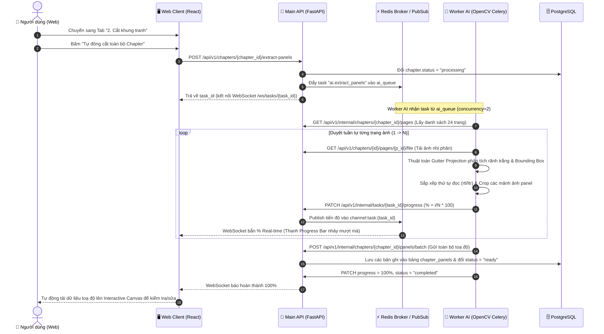

# BÁO CÁO TỔNG HỢP: WORKFLOW & GIAO DIỆN GUI MODULE 05
## Tự động Cắt khung tranh & Biên tập Panel (Panel Extraction & Editor)

> **Dự án:** Comic Review Tool (CRT)  
> **Trạng thái Module 05:** ✅ **ĐÃ HOÀN THÀNH 100%** (Backend API + Worker AI OpenCV + Web Canvas GUI + Tests)  
> **Nhánh Git:** `feature/module-05-panel-extraction`  
> **Công đoạn Pipeline:** S3 (Tách Panel & Xác định thứ tự đọc truyện)  

---

## 1. Mục tiêu Cốt lõi của Module 05
Biến toàn bộ các trang truyện scan thô (mỗi trang chứa nhiều khung tranh lồng ghép) thành:
1. **Chuỗi các khung tranh (panel) độc lập** đã được bóc tách và crop thành file ảnh riêng biệt.
2. **Thứ tự đọc chuẩn xác (1, 2, 3...)** xuyên suốt toàn bộ chapter theo phong cách đọc (`rtl` Manga, `ltr` Comic, `vertical` Webtoon).
3. **Màn hình Web Canvas Studio** trực quan cho phép người dùng kiểm tra, kéo co giãn, xóa hoặc quét chuột vẽ thêm khung tranh nếu AI nhận diện thiếu.

---

## 2. Toàn bộ Luồng Xử lý Hệ thống (End-to-End Workflow)

### 2.1. Sơ đồ Tuần tự (Sequence Diagram)


### 2.2. Cơ chế Giao tiếp 2 chiều (Ping - Pong)
* **Chiều đi (Main $\rightarrow$ Worker AI):** 
  * Main đóng gói thông tin chapter và đẩy task qua **Redis** (`ai_queue`).
* **Chiều về (Worker AI $\rightarrow$ Main):** 
  * Cứ cắt xong 1 trang ảnh, Worker AI dùng HTTP Client (`MainClient`) gọi ngược về Main API:
    `PATCH /api/v1/internal/tasks/{task_id}/progress` kèm payload:
    ```json
    {
      "progress": 25,
      "stage_message": "Đang cắt khung trang 6/24...",
      "status": "processing"
    }
    ```
* **Chiều lên Web (Main $\rightarrow$ Web Client):**
  * Main nhận request cập nhật từ Worker $\rightarrow$ ngay lập tức bắn sự kiện qua **Redis Pub/Sub** và **WebSocket** (`/api/v1/ws/tasks/{task_id}`).
  * Thanh Progress Bar trên giao diện Web nhảy số theo thời gian thực mà người dùng không cần bấm F5.

---

## 3. Kiến trúc Giao diện GUI (Web Studio Layout)

Giao diện Module 05 được thiết kế theo phong cách Dark theme **"Studio làm phim"** tại trang chi tiết Chapter:

```
┌────────────────────────────────────────────────────────────────────────────────────────────────────────┐
│  ← Quay lại   Chapter 1: Romance Dawn   [Sẵn sàng xử lý]                                               │
├────────────────────────────────────────────────────────────────────────────────────────────────────────┤
│  [1. Quản lý trang (24)]    [★ 2. Cắt khung tranh (Module 05)]                                         │
├────────────────────────────────────────────────────────────────────────────────────────────────────────┤
│  ┌─ HEADER ACTION BAR & REAL-TIME PROGRESS ──────────────────────────────────────────────────────────┐ │
│  │ Chapter 1: Romance Dawn  |  24 trang ảnh  |  78 khung đã nhận diện                                │ │
│  │ [⚡ Tự động cắt toàn bộ Chapter]                                                                   │ │
│  │ ────────────────────────────────────────────────────────────────────────────────────────────────── │ │
│  │ Tiến độ: Đang cắt khung trang 12/24 (50%)... [████████████████████░░░░░░░░░░░░░░░░░░░░] 50%       │ │
│  └───────────────────────────────────────────────────────────────────────────────────────────────────┘ │
│                                                                                                        │
│  ┌─ CỘT 1: FILMSTRIP ──┐  ┌─ CỘT 2: TRÌNH BIÊN TẬP CANVAS (TRUNG TÂM) ─────────┐  ┌─ CỘT 3: PREVIEW ─┐│
│  │ Danh sách trang     │  │ Trang 1 (800x1200px)   [3 box]    [➕ Vẽ thêm] [💾 Lưu]│  │ Panel Trang 1    ││
│  │ ─────────────────── │  │ ──────────────────────────────────────────────────── │  │ ──────────────── ││
│  │ ┌──────┐ Trang 1    │  │ ┌──────────────────────────────────────────────────┐ │  │ ┌────┐ #1 (Thứ 1)││
│  │ │ P01  │ [3 box]  ◄ │  │ │                  [#1] ───────────────┐           │ │  │ │Crop│ 700x300px ││
│  │ └──────┘ (Đang xem) │  │ │                  │                   │           │ │  │ └────┘ (50, 50)  ││
│  │ ┌──────┐ Trang 2    │  │ │                  └───────────────────┘           │ │  │ ┌────┐ #2 (Thứ 2)││
│  │ │ P02  │ [4 box]    │  │ │      [#3] ─────────────┐   [#2] ─────────────┐   │ │  │ │Crop│ 330x750px ││
│  │ └──────┘            │  │ │      │                 │   │                 │   │ │  │ └────┘ (420, 400)││
│  │ ┌──────┐ Trang 3    │  │ │      │ (Manga đọc sau) │   │ (Manga đọc trước│   │ │  │ ┌────┐ #3 (Thứ 3)││
│  │ │ P03  │ [1 box]    │  │ │      └─────────────────┘   └─────────────────┘   │ │  │ │Crop│ 330x750px ││
│  │ └──────┘            │  │ └──────────────────────────────────────────────────┘ │  │ └────┘ (50, 400)  ││
│  └─────────────────────┘  └──────────────────────────────────────────────────────┘  └──────────────────┘│
└────────────────────────────────────────────────────────────────────────────────────────────────────────┘
```

### Chi tiết 3 Khu vực Thao tác Chính:
1. **Cột 1 (Filmstrip cuộn trang bên trái):**
   * Hiển thị danh sách ảnh toàn bộ chapter theo thứ tự đọc từ trên xuống dưới.
   * Mỗi trang có thumbnail preview, số thứ tự trang, kích thước pixel và **Badge đếm số khung panel** (`3 box`, `4 box`...).
   * Bấm vào trang nào thì Canvas ở giữa lập tức chuyển sang trang đó.
2. **Cột 2 (Interactive Canvas Editor ở giữa):**
   * Nền là ảnh trang truyện sắc nét.
   * Vẽ đè các khung hình chữ nhật bán trong suốt màu xanh dương (khi click chọn sẽ chuyển sang viền đỏ nổi bật kèm 4 điểm neo ở các góc).
   * **Kéo di chuyển:** Giữ chuột vào thân khung để di chuyển vị trí.
   * **Co giãn viền:** Kéo các điểm neo ở góc để nới rộng hoặc thu hẹp khung cho sát mép hình.
   * **Vẽ thêm khung mới:** Bấm nút *"Vẽ thêm khung"* rồi dùng chuột quét tạo box mới trên ảnh.
   * **Xóa khung:** Bấm nút thùng rác/icon `✕` trên nhãn box.
   * **Lưu toạ độ:** Bấm nút *"Lưu toạ độ"* để cập nhật toạ độ mới vào PostgreSQL.
3. **Cột 3 (Thumbnail Preview bên phải):**
   * Hiển thị danh sách các mảnh ảnh panel sau khi crop thực tế.
   * Hiển thị số thứ tự `#1, #2, #3`, thứ tự trong trang và kích thước pixel $W \times H$.

---

## 4. Danh sách File Triển khai trong Dự án

| Phân hệ | Đường dẫn file | Vai trò kỹ thuật |
|---|---|---|
| **Database** | [`main/alembic/versions/20261103_0006_chapter_panels.py`](file:///D:/A45043/Project/tools/main/alembic/versions/20261103_0006_chapter_panels.py) | Migration tạo bảng `chapter_panels` |
| **Model** | [`main/app/models/chapter_panel.py`](file:///D:/A45043/Project/tools/main/app/models/chapter_panel.py) | SQLAlchemy Model bảng `ChapterPanel` |
| **Repository** | [`main/app/repositories/chapter_panel_repository.py`](file:///D:/A45043/Project/tools/main/app/repositories/chapter_panel_repository.py) | Truy vấn DB, ghi đè panel trang, đổi thứ tự đọc |
| **Service** | [`main/app/services/chapter_panel_service.py`](file:///D:/A45043/Project/tools/main/app/services/chapter_panel_service.py) | Nghiệp vụ điều phối task Celery, phân quyền chapter |
| **Controller** | [`main/app/controllers/panel_controller.py`](file:///D:/A45043/Project/tools/main/app/controllers/panel_controller.py) | Các REST API phục vụ Web Client và Internal Worker |
| **Worker AI** | [`worker-ai/app/services/panel_extractor.py`](file:///D:/A45043/Project/tools/worker-ai/app/services/panel_extractor.py) | Thuật toán OpenCV nhận diện rãnh trắng & crop ảnh |
| **Worker Task** | [`worker-ai/app/tasks/panel_tasks.py`](file:///D:/A45043/Project/tools/worker-ai/app/tasks/panel_tasks.py) | Celery task `ai.extract_panels` trên `ai_queue` |
| **Worker Client** | [`worker-ai/app/clients/main_client.py`](file:///D:/A45043/Project/tools/worker-ai/app/clients/main_client.py) | HTTP client gọi PATCH progress và POST kết quả về Main |
| **Web Canvas** | [`web/src/features/chapters/components/PanelCanvasEditor.tsx`](file:///D:/A45043/Project/tools/web/src/features/chapters/components/PanelCanvasEditor.tsx) | Canvas vẽ box, kéo thả, co giãn, xóa/thêm khung |
| **Web Tab** | [`web/src/features/chapters/components/ChapterPanelsTab.tsx`](file:///D:/A45043/Project/tools/web/src/features/chapters/components/ChapterPanelsTab.tsx) | Bố cục 3 cột Studio và thanh Progress Bar WebSocket |
| **Web Page** | [`web/src/features/chapters/pages/ChapterPagesPage.tsx`](file:///D:/A45043/Project/tools/web/src/features/chapters/pages/ChapterPagesPage.tsx) | Chia 2 Tab: Quản lý trang & Cắt khung tranh |

---

## 5. Kết quả Kiểm thử Toàn diện (Test Verification)

* **Backend Main Tests (`main/`):**
  * Chạy lệnh: `.venv\Scripts\python -m pytest`
  * Kết quả: **55 passed** / 55 tests (100% Passed trong 14.00s).
  * File test chuyên biệt [`tests/test_panels.py`](file:///D:/A45043/Project/tools/main/tests/test_panels.py) kiểm thử trọn vẹn vòng đời: Trigger $\rightarrow$ Worker báo progress $\rightarrow$ Lưu DB $\rightarrow$ Canvas sửa toạ độ $\rightarrow$ Reorder thứ tự đọc.
* **Worker AI Tests (`worker-ai/`):**
  * Chạy lệnh: `.venv\Scripts\python -m pytest worker-ai/tests`
  * Kết quả: **2 passed** / 2 tests (Thuật toán cắt khung tổng hợp & Fallback tranh toàn trang).
* **Frontend Web Build (`web/`):**
  * Chạy lệnh: `npm run typecheck` $\rightarrow$ Mã thoát `0` (Không có lỗi TypeScript).
  * Chạy lệnh: `npm run build` $\rightarrow$ Build production Vite thành công 100%.

---

## 6. Hướng dẫn Khởi chạy & Trải nghiệm Trực tiếp

1. **Khởi động Docker (Backend Main & Worker AI):**
   ```powershell
   # Mở Docker Desktop trước, sau đó chạy:
   cd d:\A45043\Project\tools\main
   docker compose up -d postgres redis api

   cd d:\A45043\Project\tools\worker-ai
   docker compose up -d worker-ai-api worker-ai-celery
   ```

2. **Khởi động Giao diện Web:**
   ```powershell
   cd d:\A45043\Project\tools\web
   npm run dev
   ```

3. **Thao tác trên Trình duyệt:**
   * Mở `http://localhost:3000` $\rightarrow$ Đăng nhập với tài khoản: `admin` / `password`.
   * Vào Dự án bất kỳ $\rightarrow$ Bấm mở 1 Chapter đã tải ảnh lên.
   * Chuyển sang Tab: **"2. Cắt khung tranh (Module 05)"**.
   * Bấm nút: **"Tự động cắt toàn bộ Chapter"** $\rightarrow$ Bạn sẽ thấy thanh Progress Bar hiển thị % thời gian thực và toàn bộ các khung tranh hiện lên Canvas để kiểm tra.
